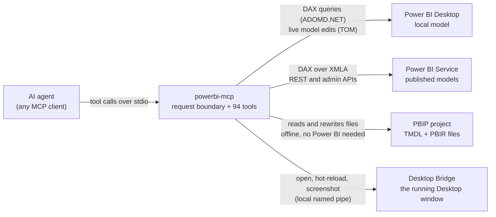

# Power BI MCP Server

<p align="center">
  <strong>A Python MCP server that lets an AI agent query, change, build and check Power BI models and reports.</strong>
</p>

<p align="center">
  <a href="CHANGELOG.md"></a>
  <a href="docs/TOOLS.md"></a>
  <a href="https://github.com/sulaiman013/powerbi-mcp/actions/workflows/tests.yml"></a>
  <a href="https://www.python.org"></a>
  <a href="LICENSE"></a>
  <a href="https://modelcontextprotocol.io"></a>
</p>

powerbi-mcp gives an AI assistant (Claude, GitHub Copilot or any other MCP client) **94 tools**
for Power BI. With them the assistant can query semantic models, change them safely, build whole
reports from one JSON spec, build custom visuals, and open the result in Power BI Desktop to take
a screenshot and check its own work. It is for Power BI developers and BI leads who want an
assistant that does the work, and for agent developers who need Power BI tools.

> **Disclaimer:** an independent community project, not affiliated with, endorsed by, or
> connected to Microsoft Corporation or Anthropic.

## Contents

- [What's new in 3.9](#whats-new-in-39)
- [From v1.0 to v3.9](#from-v10-to-v39)
- [What you can do](#what-you-can-do)
- [How it works](#how-it-works)
- [Quick start](#quick-start)
- [Tools at a glance](#tools-at-a-glance)
- [Key workflows](#key-workflows)
- [Security and governance](#security-and-governance)
- [Testing and verification](#testing-and-verification)
- [Limitations](#limitations)
- [Project structure](#project-structure)
- [Documentation](#documentation)
- [Roadmap](#roadmap)
- [Contributing](#contributing)
- [Author](#author)
- [License](#license)

## What's new in 3.9

- **Power BI's own report features in the report spec:** filters on the report, a page or a
  visual, drillthrough pages with a back button, report-page tooltips, visual interactions, the
  phone layout and bookmark groups. A filter someone adds in Desktop survives the next apply.
- **Custom visuals without the toolchain.** `build_custom_visual` packages a real `.pbiviz` from a
  short definition and a render function, with click to cross-filter, cross-highlighting,
  right-click drill through and Power BI tooltips built in.
- **Deneb charts with interactivity wired in.** `generate_deneb_spec` writes Vega-Lite specs for
  ten chart kinds and small multiples, with cross-filter, cross-highlight, tooltips and the
  context menu.
- **Open, then look closer.** `bridge_open` opens a `.pbip` or `.pbix` in Desktop and waits until
  it is ready; `bridge_screenshot` can capture one visual instead of a whole page.
- **A live pass against Power BI Desktop 2.159** found and fixed real faults: the bridge tools
  failed on current Desktop, machines with only the .NET (Core) client libraries could not
  connect, and a 260-character path stopped Desktop with a dialog the bridge cannot see.
- **A report audit that knows the new features:** unreachable drillthrough pages, unused tooltip
  pages, partial phone layouts, and which visuals are certified.

Upgrading a 3.8 spec: a tooltip page with no size is now 320 x 240, and a few inputs 3.8 accepted
are now refused. See the [changelog](CHANGELOG.md).

## From v1.0 to v3.9

The project started in November 2025 as a small read-only server for cloud models.

|  | v1.0 (Nov 2025) | v3.9 (Nov 2026) |
|---|---|---|
| Tools | 7 | 94 |
| Works with | Power BI Service only (PPU or Premium workspaces) | Power BI Desktop, Power BI Service, PBIP files on disk, and the running Desktop window |
| Can change | Nothing (read-only) | Live models (measures, relationships, in transactions), PBIP files offline (renames, measures, date tables, calculation groups, whole reports), custom visual packages |
| Checks its work | No | Validates DAX before saving, dry-runs file changes, reloads and screenshots the report in Desktop |
| Tests | None | 53 suites with 7,141 checks; CI on Windows and Linux |
| Code size | About 2,000 lines of Python | About 37,800 lines of Python in `src/` |

Tool count by release: 7 (v1.0) → 30 (v2.0) → 58 (v3.0) → 82 (v3.7) → 90 (v3.8) → 94 (v3.9).

## What you can do

A few terms first. A **semantic model** is the data model behind a report (tables, relationships,
measures). A **measure** is a saved formula in **DAX**, Power BI's formula language. **PBIP**
(Power BI Project) saves the model (as TMDL) and the report (as PBIR) as text files. **RLS** is
row-level security.

**Explore and query.** List tables, columns, measures and relationships, or ask a question in
plain words and let the agent write and run the DAX, on Desktop or a published model.
> "Connect to my Power BI Desktop and show me the top 10 products by sales last quarter."

**Check model quality.** A Best Practice Analyzer (33 rules), an AI-readiness score, storage
analysis, a DAX linter with rewrites, a star-schema audit, an orphan-key scan, a naming audit, and
a search for columns and measures nothing uses.
> "Audit this model and give me the top issues to fix before I ship."

**Change models safely.** DAX is checked against the model before it is saved, and edits can be
held in a transaction. Generate measure suites (time intelligence, ratios, ranks), date tables,
calculation groups and hierarchies, live or straight into PBIP files.
> "Generate the time-intelligence measures for 'Total Sales' over Date[Date] and add them to the model."

**Rename safely across model and report.** A rename updates the model and every visual, filter
and bookmark that uses the name, in one change that writes all files or none.
> "What uses the 'Customer ID' column? Rename it to 'Customer Key' everywhere."

**Build reports as code.** Describe the report once in a JSON spec and the server writes the
files. Applying it again changes nothing; a mistake stops the apply before any file is written.
It also generates HTML and SVG measures, audits a report's design and stages it for publishing.
> "Build a two-page report from this spec, with a drillthrough page for customer segment."

**Custom visuals and Deneb.** Build a real `.pbiviz` from a short definition, or generate a Deneb
chart. Unlike an HTML measure, both cross-filter the page on click and offer drill through.
> "Turn this ranked list into a custom visual I can click to filter the page."

**See and verify in Power BI Desktop.** Through Microsoft's Desktop Bridge (Desktop June 2026 or
later) the agent opens a report, hot-reloads it after editing the files, and takes screenshots.
> "Add the chart, reload Desktop, and screenshot the page so you can check the layout."

**Security and governance.** Tools that run your DAX accept queries only and apply column
policies, PII masking and an audit log. A read-only mode lets an agent look but not touch.
> "Show me the security status and check that the audit log has not been changed."

**Operations and fleet.** Diff a model against a snapshot, run a pre-deploy gate and DAX
regression tests, explain a failed refresh, test every RLS role; admins get tenant-wide lineage.
> "Why did the last refresh fail, and what should I do about it?"

## How it works

Your MCP client starts the server on your machine and talks to it over stdio. Every call passes
one request boundary (read-only gate, query guard, access policies, secret redaction), then takes
one of four paths. The live paths need Windows; the PBIP path runs on any OS.



Microsoft ships official Power BI MCP servers in preview: a remote one for chatting with data and
a local one for authoring semantic models. This project complements them with renames that also
fix the report, reports built from a spec, an access-policy layer, RLS testing, and offline PBIP
work with no Fabric capacity. Details: [docs/ARCHITECTURE.md](docs/ARCHITECTURE.md).

## Quick start

### 1. Requirements

| To use | You need |
|---|---|
| Offline tools (PBIP editing, report spec, generators, linters, audits, security) | Any OS, Python 3.10+ |
| Power BI Desktop live (queries, validation, live edits) | Windows 10/11, Power BI Desktop, Python 3.10+, ADOMD.NET (plus AMO/TOM for edits) |
| Desktop Bridge (open, hot-reload, screenshots) | Power BI Desktop June 2026 or later, preview option "Enable external tool access to Power BI Desktop through secure local APIs" (File > Options > Preview features; on by default) |
| Power BI Service | An Azure AD service principal; XMLA needs Premium, PPU or Fabric capacity |

Both requirement files pin the MCP Python SDK to `mcp>=1.10.0,<2`; the server does not run on
mcp 2.x yet and says so at start-up.

**Analysis Services client libraries (live connectivity only).** Newer Power BI Desktop builds no
longer ship ADOMD.NET. Install SQL Server Management Studio (SSMS), or fetch both NuGet packages
once and point the server at them:

```bash
# one-time: fetch ADOMD + AMO/TOM from NuGet and extract the DLLs
curl -L -o adomd.nupkg "https://www.nuget.org/api/v2/package/Microsoft.AnalysisServices.AdomdClient.retail.amd64"
curl -L -o amo.nupkg   "https://www.nuget.org/api/v2/package/Microsoft.AnalysisServices.retail.amd64"
# unzip both (they are ZIP files) and copy lib/net45/*.dll into one folder, e.g. C:\pbi-dlls
# then set:  ADOMD_DLL_PATH=C:\pbi-dlls
```

The server also searches Power BI Desktop, the GAC, SSMS, the SQL Server SDK and the NuGet cache
by itself; `ADOMD_DLL_PATH` and `TOM_DLL_PATH` override the search.

### 2. Install

```bash
git clone https://github.com/sulaiman013/powerbi-mcp.git
cd powerbi-mcp
pip install -r requirements.txt    # full install (Windows, live connectivity)
```

For the offline subset on any OS, install `requirements-core.txt` instead.

### 3. Connect your MCP client

For Claude Desktop, add this to `%APPDATA%\Claude\claude_desktop_config.json` (with the absolute
path of your clone), then restart Claude Desktop:

```json
{
  "mcpServers": {
    "powerbi": {
      "command": "python",
      "args": ["C:/path/to/powerbi-mcp/src/server.py"],
      "env": {
        "PYTHONPATH": "C:/path/to/powerbi-mcp/src"
      }
    }
  }
}
```

Other MCP clients that start local stdio servers take the same command, arguments and
environment in their own settings.

### 4. Your first five minutes

Open a report in Power BI Desktop, then ask:

1. "Find my open Power BI Desktop and connect to it."
2. "Summarize the model: tables, measures and relationships."
3. "Run the Best Practice Analyzer and list the five most important issues."
4. "Lint every measure and suggest a rewrite for the worst one."
5. "Which file is open in Desktop? Take a screenshot of the first page." (needs the Desktop Bridge)

None of these change your model or your report.

### 5. Optional: Power BI Service credentials

```bash
cp .env.example .env    # Windows: copy .env.example .env
```

Fill in `TENANT_ID`, `CLIENT_ID` and `CLIENT_SECRET` for a service principal. The server reads
`.env` at start-up; every setting in it is optional, and Desktop and PBIP work need none of them.

### 6. Optional: Docker (offline subset)

The image runs the platform-independent tools (PBIP editing, the report spec, BPA, model
analysis, security, resources and prompts) with no .NET. Mount your PBIP project at `/work`:

```bash
docker build -t powerbi-mcp .
docker run --rm -i -v /path/to/MyReport:/work powerbi-mcp
```

## Tools at a glance

94 tools in total. The counts come from the sections of [docs/TOOLS.md](docs/TOOLS.md), which
lists every tool with its read, write or destructive mark.

| Area (sections in docs/TOOLS.md) | Count | Main tools |
|---|:-:|---|
| Connect and query: Desktop (7), Cloud (6) | 13 | `desktop_connect`, `desktop_execute_dax`, `desktop_get_model_info`, `list_workspaces`, `execute_dax` |
| Security and audit (3), Row-Level Security (3) | 6 | `security_status`, `verify_audit_integrity`, `desktop_set_rls_role` |
| Live changes: Model writes via TOM (7), DAX safety loop and transactions (5), Relationships (2) | 14 | `validate_dax`, `create_measure`, `tom_begin_transaction`, `tom_commit_transaction`, `create_relationship` |
| Offline PBIP: safe editing (6), diagnostics and repair (4) | 10 | `pbip_load_project`, `pbip_rename_tables`, `pbip_rename_columns`, `pbip_rename_measures`, `pbip_undo` |
| Model authoring: Bulk DAX creation (3), Data modelling (3), Authoring helpers (2) | 8 | `generate_measure_suite`, `pbip_add_measures`, `pbip_create_date_table`, `pbip_add_calculation_group` |
| Reports: Report authoring (4), Report as code (7) | 11 | `pbir_apply_spec`, `audit_report_design`, `generate_html_measure`, `pbip_stage_publish` |
| Custom visuals and Deneb (3) | 3 | `build_custom_visual`, `inspect_custom_visual`, `generate_deneb_spec` |
| Quality: Model quality and performance (4), DAX quality (2), Custom BPA governance (2), Warehouse audit (2) | 10 | `run_bpa`, `audit_ai_readiness`, `dax_lint`, `audit_star_schema`, `scan_referential_integrity` |
| Power BI Desktop Bridge (5) | 5 | `bridge_open`, `bridge_status`, `bridge_reload`, `bridge_screenshot` |
| Operations: Documentation, diff and CI (5), Diagnostics and ops (4), PBIX onboarding (2) | 11 | `model_diff`, `pre_deploy_gate`, `run_dax_tests`, `refresh_doctor`, `impact_analysis`, `pbix_inspect` |
| Governance-ops fleet, admin only (3) | 3 | `cross_workspace_lineage`, `fleet_refresh_monitor`, `usage_and_orphan_analytics` |
| **Total** | **94** | |

<details>
<summary>Resources, prompts, completion and annotations</summary>

- **Resources:** `powerbi://desktop/schema`, `.../measures`, `.../bpa`, `.../ai-readiness`, the
  template `powerbi://cloud/{workspace}/{dataset}/schema`, `powerbi://reference/bpa-rules` and
  `powerbi://reference/refresh-errors`.
- **Prompts:** `optimize_measure`, `explain_measure`, `audit_model`, `document_model`,
  `plan_safe_rename`, `pre_deploy_review`. **Completion** fills prompt and resource arguments.
- **Annotations:** every tool declares `readOnlyHint`, `destructiveHint`, `idempotentHint` and
  `openWorldHint`, so a client can approve reads and confirm writes; 33 return `structuredContent`.

</details>

## Key workflows

### Safe renames

Power BI keeps the model and the report in separate files. A rename through the live model (TOM)
changes the model but not the report, so every visual that used the old name breaks. The
`pbip_rename_*` tools rewrite both layers in one all-or-nothing change.

```text
You:    Load the PBIP project in C:/Projects/SalesReport.
You:    Rename the table Salesforce_Data to Sales Force Data.
Agent:  pbip_load_project -> pbip_rename_tables -> bridge_reload
```

Nothing is written if the old name is missing, the new name collides, or a reference would break.
Files keep their encoding and line endings, text that only mentions the name (a title) is listed
for review, and `pbip_undo` restores the previous state. Do not use the deprecated
`batch_rename_*` tools.

### Report as code

This spec builds an overview page with a year filter, and a drillthrough page for segment:

```json
{
  "pages": [
    {"name": "overview", "display_name": "Overview",
     "filters": [{"field": "Calendar.Year", "in": [2025, 2026]}],
     "elements": [
       {"name": "by_segment", "type": "visual", "visual_type": "barChart",
        "x": 24, "y": 24, "width": 600, "height": 400,
        "fields": {"Category": "Customer.Segment", "Y": "Sales.Total Sales"}}]},
    {"name": "detail", "display_name": "Segment detail",
     "drillthrough": {"fields": ["Customer.Segment"], "back_button": true},
     "elements": [
       {"name": "orders", "type": "visual", "visual_type": "tableEx",
        "x": 24, "y": 72, "width": 1232, "height": 600,
        "fields": {"Values": [{"column": "Customer.Name"}, {"measure": "Sales.Total Sales"}]}}]}
  ]
}
```

Ask the agent to run `pbir_apply_spec` with `dry_run: true` first, then for real. Every field is
checked against the model before a file is written, and pages the spec did not create are never
touched. The full format is in [docs/REPORT_SPEC.md](docs/REPORT_SPEC.md).

### Build a custom visual

A definition names the data roles and a render function returns HTML. An element with `data-row`
becomes a data point: click cross-filters, right-click offers drill through, hover shows the
tooltip.

```json
{
  "name": "simpleList",
  "display_name": "Simple list",
  "author": {"name": "Your name"},
  "roles": [
    {"name": "category", "kind": "grouping"},
    {"name": "value", "kind": "measure", "max": 1}
  ],
  "css": ".row { padding: 4px 8px; } .row.vk-selected { font-weight: 600; }",
  "js_files": ["render.js"]
}
```

```javascript
// render.js, next to definition.json
function render(ctx) {
  return ctx.rows.map(function (row) {
    return '<div class="row" data-row="' + row.index + '">' +
      ctx.escape(row.text.category) + ': ' + ctx.escape(row.text.value) + '</div>';
  }).join("");
}
```

`build_custom_visual` turns it into a `.pbiviz`. To build and place it in one step, list it in a
report spec, `"custom_visuals": [{"definition": "visuals/simple_list/definition.json", "alias": "simple"}]`,
and give a visual element `"custom": "simple"`. Four complete visuals are in
[examples/custom_visuals/](examples/custom_visuals/).

### Edit, reload, screenshot

With Power BI Desktop June 2026 or later, the agent checks its own work in the running app:

```text
bridge_open            open the project in Desktop and wait for the bridge (skip if it is open)
bridge_status          which file is open, unsaved changes, pages, the Analysis Services port
pbip_* / pbir_* tools  edit offline: measures, date table, pages, visuals, the whole spec
bridge_reload          hot-reload the open file from disk; no close and reopen
bridge_screenshot      PNG of each page, or of one visual, for the agent to look at and fix
```

`bridge_reload` refuses to run over unsaved Desktop changes unless you pass `force=true`.

## Security and governance

- **Query-only.** Tools that run your DAX accept DAX queries only; TMSL, XMLA and MDX are refused.
- **Column and table policies** in [config/policies.yaml](config/policies.yaml): block, mask,
  hash, redact or numeric-mask a column; cap rows or require a filter on a table. They follow
  aliases and measures, and every tool that runs DAX applies them.
- **Fail closed.** A missing or invalid policy file refuses queries; `security_status` says why.
- **PII masking** on results (SSN, credit card, email, phone, IP address), with value checks so
  dates and ordinary text are left alone.
- **Audit log** with a hash chain (`verify_audit_integrity`); `POWERBI_MCP_AUDIT_KEY` makes it
  HMAC-SHA256, and without a key it only catches accidental edits.
- **Secret redaction** on every response and in the logs.

**Read-only mode:** set `POWERBI_MCP_READONLY=true` in `.env` or in the `env` block of your MCP
client config. Every tool that changes a model, a report or a file is then refused; reads keep
working. A value that cannot be read as true or false also turns it on.

The policies work on query text and result names: defence in depth, not a security boundary.
Row-level and object-level security in the semantic model is the boundary.

<details>
<summary>Essential environment variables</summary>

| Variable | Purpose |
|---|---|
| `TENANT_ID`, `CLIENT_ID`, `CLIENT_SECRET` | Service principal for the Power BI Service tools |
| `ADOMD_DLL_PATH` | Folder (or full path) of `Microsoft.AnalysisServices.AdomdClient.dll`, if the search misses it |
| `TOM_DLL_PATH` | Folder (or full path) of `Microsoft.AnalysisServices.Tabular.dll` for live edits (`ADOMD_DLL_PATH` is searched too) |
| `PYTHONNET_RUNTIME` | `coreclr` when only the .NET (Core) builds of ADOMD/TOM are installed |
| `POWERBI_MCP_READONLY` | Refuse every tool that changes something. Accepts 1/true/yes/on |
| `POWERBI_MCP_QUERY_TIMEOUT` | Seconds before a DAX query is cancelled (default 120) |
| `POWERBI_MCP_POLICY_FILE` | Your own policy file instead of `config/policies.yaml`; missing or invalid means queries are refused |
| `POWERBI_MCP_AUDIT_KEY` | Secret that switches the audit hash chain to HMAC-SHA256 |
| `POWERBI_MCP_PBIP_BACKUPS` | `false` stops the automatic project backup before a rename or repair |
| `LOG_LEVEL` | `DEBUG` turns on argument logging (secrets redacted) |

The full list is in [docs/TOOLS.md](docs/TOOLS.md#environment-variables);
[.env.example](.env.example) has every setting with a comment.

</details>

## Testing and verification

The 53 suites in `tests/` are plain assert-based Python scripts. They need no Power BI, ADOMD or
.NET: pure logic is tested directly, the server and live connectors run against fakes.

```bash
python run_tests.py                 # all suites
python run_tests.py rename dax      # only suites whose file name contains one of these words
python tests/test_docs_parity.py    # one suite
```

A suite fails if it exits non-zero or prints a failed check. CI
([tests.yml](.github/workflows/tests.yml)) runs every suite on each push to `master` and each
pull request, on Windows and Linux with Python 3.10, 3.12 and 3.13.

| Verified | How |
|---|---|
| Pure logic: tokenizer, renames, report spec, generators, linters, auditors, security | 53 suites, 7,141 checks |
| Rename engine, report spec, report audit | Also run on copies of real, complex reports; renames and the spec checked byte for byte |
| Desktop live tools | Run against Power BI Desktop 2.159 on 2026-11-11: connect, DAX, `validate_dax`, model audits, a TOM transaction rolled back, the bridge (open, reload, page and single-visual screenshots) |
| Generated reports, Deneb charts, built custom visuals | Loaded and drawn in Desktop 2.159; a built visual's selection, highlight, tooltip and context-menu calls were answered by the real host |

**Not verified:**

- **Clicks and hovering.** The bridge cannot click or hover, so clicking to filter, drilling
  through, tooltip pages on hover and the phone view were not observed. Click through once.
- **Generated DAX and M** are checked for shape and lint, not run by an engine. Use `validate_dax`.
- **The cloud paths** (XMLA, REST, admin APIs) are tested with fakes and checked against
  Microsoft Learn; they have not run against a tenant. Not every Desktop tool ran live either,
  and the rename engine has not been re-run live since its 3.8 rewrite.

Details: [docs/TESTING.md](docs/TESTING.md).

## Limitations

| Limitation | Notes |
|---|---|
| Live connectivity is Windows only | ADOMD.NET, TOM and the bridge's named pipe need Windows. The offline subset runs anywhere, also in Docker. |
| A live (TOM) rename breaks report visuals | Use the `pbip_rename_*` tools, which update the report too. |
| The Desktop Bridge is a preview | Its protocol changed in Desktop 2.159; the client follows the running build's manifest, but a later build can change it again. A single-visual screenshot needs `report.snapshot.capture/v2`. The bridge cannot click or save. |
| Some visuals are not certified | Private `.pbiviz` visuals (built ones included) and HTML Content Regular are blocked where only certified visuals are allowed. Deneb (AppSource edition) and HTML Content Secure are certified. |
| The custom visual runtime is small on purpose | One categorical data mapping: no table or matrix mapping, no per-point conditional formatting, no localisation. |
| Cloud tools need the right capacity and rights | XMLA needs Premium, PPU or Fabric capacity (basic refresh history works on Pro). The fleet tools need Fabric admin or a service principal allowed to use the read-only admin APIs. |
| No storage-engine timings | `analyze_query_performance` gives duration and hints; use DAX Studio for formula- versus storage-engine timings. |

## Project structure

```text
powerbi-mcp/
├── src/
│   ├── server.py                  MCP server: tool registry, request boundary, handlers
│   ├── powerbi_*_connector.py     Desktop (ADOMD), XMLA, REST, TOM and PBIP connectors
│   ├── desktop_bridge.py          Desktop Bridge client (JSON-RPC over a named pipe)
│   ├── pbip_rename.py             rename engine (with pbip_report, pbip_json, pbip_mquery, tmdl_scan)
│   ├── report_spec.py             report as code (with pbir_builders, pbir_filters, report_audit)
│   ├── custom_visual.py           .pbiviz builder; visual_kit/ holds the visual's runtime
│   ├── dax_tokens.py, safe_io.py  shared DAX tokenizer, atomic file writes
│   └── security/                  policies, PII masking, audit log, redaction
├── config/policies.yaml           access policies
├── examples/custom_visuals/       four example visual definitions
├── tests/ + run_tests.py          assert-based suites and their runner
├── docs/                          TOOLS, REPORT_SPEC, ARCHITECTURE (full file map), TESTING
└── Dockerfile, requirements*.txt, AGENTS.md, CHANGELOG.md
```

## Documentation

| Document | Contents |
|---|---|
| [docs/TOOLS.md](docs/TOOLS.md) | Every tool with its safety mark, plus resources, prompts and environment variables |
| [docs/REPORT_SPEC.md](docs/REPORT_SPEC.md) | The report spec behind `pbir_apply_spec`, with a full example |
| [docs/ARCHITECTURE.md](docs/ARCHITECTURE.md) | Components, request boundary, security layer, file map |
| [docs/TESTING.md](docs/TESTING.md) | How to run the suites, what each covers, what was verified live |
| [AGENTS.md](AGENTS.md) | Playbook for agents: golden rules, workflows, choosing a visual technique |
| [CHANGELOG.md](CHANGELOG.md) | Every change, by release |
| [examples/custom_visuals/](examples/custom_visuals/) | Four custom visual definitions to build from |

## Roadmap

- A trace-based DAX optimization loop (formula- versus storage-engine timings).
- Refresh trigger, monitor and cancel.
- PyPI packaging and tagged releases.
- Live runs of the cloud paths against a tenant, and a way to click through generated reports.
- Report spec: data state inside bookmarks. Custom visuals: table and matrix mappings.
- A port to the mcp SDK 2.x, and a remote HTTP transport with Microsoft Entra sign-in.

## Contributing

1. Fork the repository and create a feature branch.
2. Register a new tool in `build_tools`, `_build_tool_dispatch` and `_build_tool_annotations` in
   `src/server.py`, and in `docs/TOOLS.md`. Parity tests check both.
3. Read and rewrite DAX through `src/dax_tokens.py`; write files through `src/safe_io.py`.
4. Run `python run_tests.py`, keep every suite green, and open a pull request.

Formatting conventions are in `pyproject.toml` and `.editorconfig`.

## Author

**Sulaiman Ahmed**, Data Analytics Engineer and Microsoft Certified Professional.

[](https://github.com/sulaiman013)
[](https://sulaiman-ahmed.lovable.app)

## License

MIT. See [LICENSE](LICENSE).

**Acknowledgments:** the [Model Context Protocol](https://modelcontextprotocol.io) by Anthropic;
Microsoft's TOM, TMDL and PBIR documentation; and the Power BI community, for insights on the
PBIP format and semantic-model best practices.
